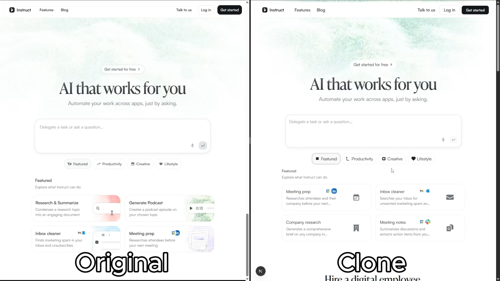

<div align="center">

# AI Website Cloner Template

### Clone any website with one command

Give your AI coding agent a URL and watch it recreate the website as a clean Next.js app.

**Best results with [Claude Code](https://docs.anthropic.com/en/docs/claude-code) + Opus 5.5. Also supports Codex, Cursor, and OpenCode.**

[Quick Start](#quick-start) · [Watch Demo](#demo) · [Supported Platforms](#supported-platforms)

English · [繁體中文](README.zh.md)

</div>

---

## Demo

[](https://youtu.be/O669pVZ_qr0)

> Click the image above to watch the full demo on YouTube.

## Quick Start

> **The tool is public; your clones stay private.**
> This repo is the cloning tool and stays public. Each cloned site is written to **a separate output folder** (ideally backed by a private repo) that holds **only the website**, with none of the tool files, and the tool repo never receives cloned content.

The steps below output to `../storemap` as an example.

### 1. Prepare the tool (once)

```bash
git clone https://github.com/JacobHsu/ai-website-cloner.git
cd ai-website-cloner
npm install
```

### 2. Prepare the output folder

To keep it on GitHub, create a **private** repo and clone it **outside** the tool folder:

```bash
gh repo create <your-account>/storemap --private --add-readme
git clone git@github.com:<your-account>/storemap.git ../storemap
```

To keep it local only, an empty folder is enough.

### 3. Clone from the tool into that folder

Open your agent in the **tool folder** with browser access enabled. In Claude Code or Cursor, run:

```text
/clone-website https://example.com --out ../storemap
```

The agent will:

1. create the site skeleton with `npm run scaffold -- ../storemap` if the output folder has none, and run `npm install` there
2. inspect the source site and write pages, components, assets, and research notes into the **output folder**
3. compare with `npm run dev` and verify with `npm run check` in the output folder

Because the agent reads and writes outside the tool folder, Claude Code may ask you to allow access to the output folder.

### 4. Preview and save

```bash
cd ../storemap
npm run dev        # preview at http://localhost:3000
git add -A
git commit -m "Clone storemap"
git push           # goes only to your private repo
```

### What the output folder contains

Only a runnable Next.js site: `src/`, `public/`, `package.json` and build config, plus the clone's research notes in `docs/research/` and screenshots in `docs/design-references/`.

It does not get `.agents/`, `.claude/`, `AGENTS.md`, `CLAUDE.md`, `scripts/`, or the tool's README and LICENSE.

You can also create the skeleton yourself with `npm run scaffold -- <folder>`. It leaves the target's `.git` alone and never overwrites existing files.

## Supported Platforms

| Agent                                                         | Status                     |
| ------------------------------------------------------------- | -------------------------- |
| [Claude Code](https://docs.anthropic.com/en/docs/claude-code) | **Recommended** — Opus 5.5 |
| [Codex CLI](https://github.com/openai/codex)                  | Supported                  |
| [OpenCode](https://opencode.ai/)                              | Supported                  |
| [Cursor](https://cursor.com/)                                 | Supported                  |

## Prerequisites

- [Node.js](https://nodejs.org/) 24+
- An AI coding agent (see [Supported Platforms](#supported-platforms))

## Tech Stack

- **Next.js 16** — App Router, React 19, TypeScript strict
- **shadcn/ui** — Base UI primitives + Tailwind CSS v4
- **Tailwind CSS v4** — oklch design tokens
- **Lucide React** — default icons (replaced by extracted SVGs during cloning)

## How It Works

The `/clone-website` skill follows four steps:

1. **Map** — map source URLs to local routes and preserve existing work.
2. **Observe** — inspect desktop/mobile pages, extract real assets and fonts, and exercise alternate states.
3. **Build** — implement editable components and working interactions; delegate independent sections when useful.
4. **Compare** — review source and local pages at matched sizes/states, repair visible differences, and run the production check.

Framer pages and animated sites have focused inspection guidance for responsive variants, media, sticky scenes, and scroll/time-driven motion. Direct HTTP or asset tools handle extraction where practical; browser comparisons establish appearance and behavior. Deliverables include route mappings, run instructions, comparison screenshots, and any remaining gaps.

## Use Cases

- **Platform migration** — rebuild a site you own from WordPress/Webflow/Squarespace into a modern Next.js codebase
- **Lost source code** — your site is live but the repo is gone, the developer left, or the stack is legacy. Get the code back in a modern format
- **Learning** — deconstruct how production sites achieve specific layouts, animations, and responsive behavior by working with real code

## Not Intended For

- **Phishing or impersonation** — this project must not be used for deceptive purposes, impersonation, or any activity that breaks the law.
- **Passing off someone's design as your own** — logos, brand assets, and original copy belong to their owners.
- **Violating terms of service** — some sites explicitly prohibit scraping or reproduction. Check first.

## Project Structure

```
src/
  app/              # Next.js routes
  components/       # React components
    ui/             # shadcn/ui primitives
    sites/<site>/   # Source-specific components and extracted SVGs
  lib/utils.ts      # cn() utility
  types/            # TypeScript interfaces
  hooks/            # Custom React hooks
public/
  sites/<site>/     # Source-specific images, fonts, videos, and other assets
docs/
  research/<site>/  # Page brief, asset map, and inspection evidence
  design-references/ # Screenshots
.agents/skills/
  clone-website/    # Canonical skill and inspection reference
.claude/commands/
  clone-website.md  # Thin Claude Code bridge
AGENTS.md           # Agent instructions (single source of truth)
CLAUDE.md           # Claude Code config (imports AGENTS.md)
```

## Commands

```bash
npm run dev    # Start dev server
npm run build  # Production build
npm run lint   # ESLint check
npm run typecheck # TypeScript check
npm run check  # Run lint + typecheck + build
npm run scaffold -- <output-folder>  # create the site skeleton in an output folder
```

### If using docker

```bash
docker compose up app --build # build and run the app
docker compose up dev --build # run the app in dev mode on port 3001
```

## Agent Support

The project keeps one portable Agent Skill at `.agents/skills/clone-website/`. Codex, Cursor, and OpenCode read it directly. Claude Code uses the small command bridge at `.claude/commands/clone-website.md` so `/clone-website` and its arguments continue to work without exposing a duplicate skill to the other agents.

## License

MIT
