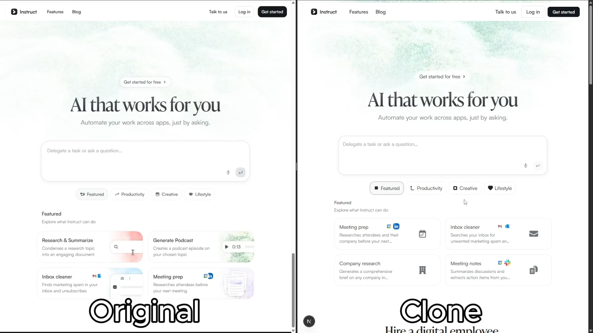

<div align="center">

# AI 網站複製模板

### 一個指令複製任何網站

給你的 AI 程式代理一個網址，看它把網站重建成乾淨的 Next.js 應用程式。

**搭配 [Claude Code](https://docs.anthropic.com/en/docs/claude-code) + Opus 5.5 效果最佳。也支援 Codex、Cursor 與 OpenCode。**

[快速開始](#快速開始) · [觀看示範](#示範) · [支援平台](#支援平台)

[English](README.md) · 繁體中文

</div>

---

## 示範

[](https://youtu.be/O669pVZ_qr0)

> 點擊上方圖片，到 YouTube 觀看完整示範。

## 快速開始

### 1. 建立你的專案

**推薦做法：交給你的代理。** 把下面這段貼到 Codex、Claude Code 或你使用的程式代理：

```text
把 https://github.com/JCodesMore/ai-website-cloner-template
設定成我電腦上一個新資料夾裡的獨立專案。
先問我要放在哪裡。clone 這個 repository、移除它的 origin remote、
安裝相依套件，並執行 npm run check。完成後讓它處於
可以開始複製網站的狀態。
```

### 2. 複製網站

在你的代理中開啟專案，並啟用瀏覽器存取。在 Claude Code 或 Cursor 中執行：

```text
/clone-website https://example.com
```

把網址換成你想重建的網站。建置完成後，可以再請代理做任何你想要的修改。

## 支援平台

| 代理                                                          | 狀態                    |
| ------------------------------------------------------------- | ----------------------- |
| [Claude Code](https://docs.anthropic.com/en/docs/claude-code) | **推薦** — Opus 5.5     |
| [Codex CLI](https://github.com/openai/codex)                  | 支援                    |
| [OpenCode](https://opencode.ai/)                              | 支援                    |
| [Cursor](https://cursor.com/)                                 | 支援                    |

## 事前準備

- [Node.js](https://nodejs.org/) 24 以上
- 一個 AI 程式代理（見[支援平台](#支援平台)）

## 技術堆疊

- **Next.js 16** — App Router、React 19、TypeScript strict
- **shadcn/ui** — Base UI primitives + Tailwind CSS v4
- **Tailwind CSS v4** — oklch 設計 token
- **Lucide React** — 預設圖示（複製過程中會被擷取出的 SVG 取代）

## 運作方式

`/clone-website` skill 依照四個步驟進行：

1. **對照（Map）** — 把來源網址對應到本機路由，並保留既有的成果。
2. **觀察（Observe）** — 檢查桌面版與行動版頁面，擷取真實的素材與字型，並操作各種互動狀態。
3. **建置（Build）** — 實作可編輯的元件與可運作的互動；需要時把獨立的區塊分派出去平行處理。
4. **比對（Compare）** — 在相同尺寸與狀態下檢視來源頁面和本機頁面，修正看得出來的差異，並執行正式環境檢查。

針對 Framer 頁面與動畫網站，有專門的檢查指引，涵蓋響應式變體、媒體、黏性（sticky）場景，以及捲動或時間驅動的動畫。能直接用 HTTP 或素材工具擷取的就直接擷取；外觀與行為則透過瀏覽器比對來確認。產出內容包含路由對照、執行說明、比對截圖，以及尚未解決的差異。

## 使用情境

- **平台遷移** — 把你自己的網站從 WordPress、Webflow、Squarespace 重建成現代化的 Next.js 程式碼庫
- **原始碼遺失** — 網站還在線上，但 repo 不見了、開發者離職了，或技術架構太舊。用現代化的格式把程式碼找回來
- **學習** — 透過實際的程式碼，拆解正式網站如何做出特定的版面、動畫與響應式行為

## 不適用於

- **網路釣魚或冒充** — 本專案不得用於欺騙、冒充他人，或任何違法的行為。
- **把別人的設計當成自己的** — 商標、品牌素材與原創文案屬於其擁有者。
- **違反服務條款** — 有些網站明確禁止爬取或複製。請先確認。

## 專案結構

```
src/
  app/              # Next.js 路由
  components/       # React 元件
    ui/             # shadcn/ui 基礎元件
    sites/<site>/   # 各來源網站專屬元件與擷取出的 SVG
  lib/utils.ts      # cn() 工具函式
  types/            # TypeScript 介面
  hooks/            # 自訂 React hooks
public/
  sites/<site>/     # 各來源網站專屬的圖片、字型、影片與其他素材
docs/
  research/<site>/  # 頁面簡介、素材對照表與檢查證據
  design-references/ # 截圖
.agents/skills/
  clone-website/    # 標準 skill 與檢查參考資料
.claude/commands/
  clone-website.md  # 精簡的 Claude Code 橋接
AGENTS.md           # 代理指示（唯一的標準來源）
AGENTS.zh.md        # AGENTS.md 的繁體中文版（僅供閱讀）
CLAUDE.md           # Claude Code 設定（匯入 AGENTS.md）
```

## 指令

```bash
npm run dev    # 啟動開發伺服器
npm run build  # 正式環境建置
npm run lint   # ESLint 檢查
npm run typecheck # TypeScript 型別檢查
npm run check  # 執行 lint + typecheck + build
```

### 使用 Docker 的話

```bash
docker compose up app --build # 建置並執行應用程式
docker compose up dev --build # 以開發模式在 3001 埠執行
```

## 代理支援

本專案在 `.agents/skills/clone-website/` 維護一份可攜的 Agent Skill。Codex、Cursor 與 OpenCode 會直接讀取它。Claude Code 則透過 `.claude/commands/clone-website.md` 這個小型指令橋接，讓 `/clone-website` 和它的參數照常運作，同時不會讓其他代理看到重複的 skill。

## 授權

MIT
